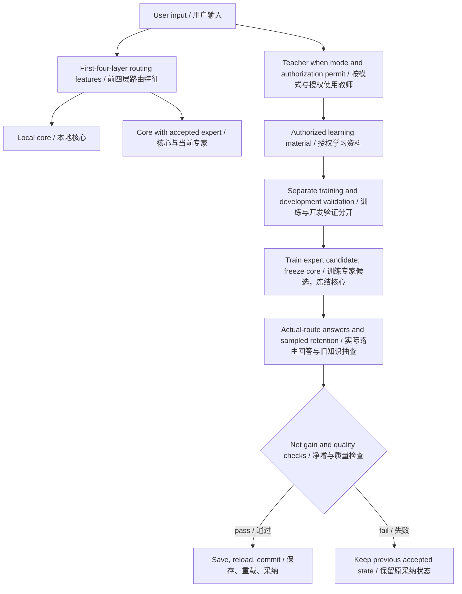

# Luban Zero architecture / 鲁班零号当前架构

Technical Report v0.1 · Research Preview · 2026-10-22

[Main report](../paper/Luban_Technical_Report.md) · [中文补充](../paper/Luban_Technical_Report_ZH.md)

## Current execution / 当前执行

- Foundation: Qwen3.5-2B-derived MLX 4-bit weights, with accepted core/expert/router artifacts. / 基座为Qwen3.5-2B衍生MLX 4bit，配套已采纳的核心修改、专家和路由。
- Current daily learning and Evolution actions use the expert-learning path. / 当前日常学习和进化入口均使用专家学习路径。
- ASR uses a separate Qwen3-ASR-0.6B model. / 语音识别使用独立Qwen3-ASR-0.6B。
- Model loading is manual; automatic learning requires a running available model and sufficient eligible material. / 模型手动启动，自动学习依赖已启动且可用的模型及足量合格资料。
- A fresh installation inherits a verified factory baseline but no personal learning achievements. / 新安装继承出厂基线，不计为用户个人学习成果。

## Research direction / 研究方向

Automatic long-term specialization into many independent experts, useful cold-expert scheduling, and core consolidation remain unestablished in the current daily MLX path. Disk storage alone is not evidence of continual-learning gains.

自动长期分化多个独立专家、冷专家调度的效果，以及核心合并，尚未在当前日常MLX流程中确立；权重能保存在磁盘上不等于已经证明持续学习收益。
